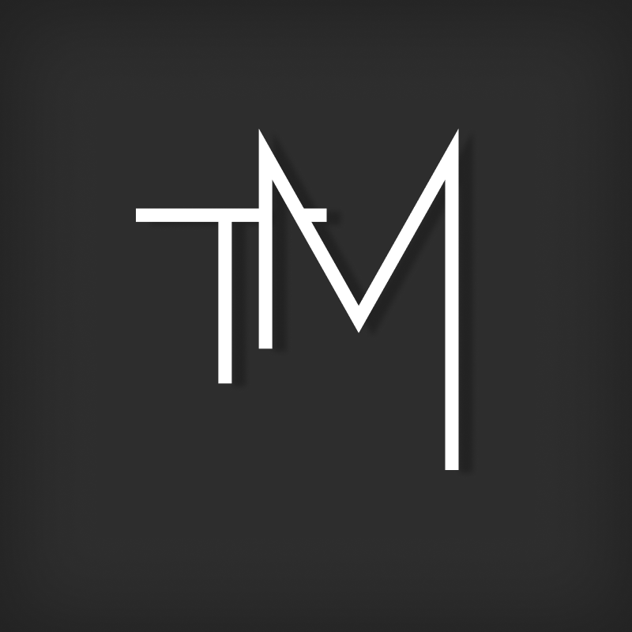

<div align="center">



# Tiago Marques · Portfolio

**Software Developer & Audio Engineer**

Personal portfolio website showcasing my audio plugins (**ALMA** and **TMVerb**), software projects and music production.

[Live site](#) · [LinkedIn](https://www.linkedin.com/in/tiago-marques-789b3031b/) · [YouTube](https://www.youtube.com/@TiagoM_Music)


</div>

---

## About

A single-page portfolio built with **plain HTML, CSS and JavaScript**: no frameworks, no build step, no dependencies. It works as a small app with tab-style panels (Home, About, Audio Plugins, Other Projects, Contact), with hash-based navigation so the browser's back and forward buttons work as expected.

The site is fully bilingual (**English / Portuguese**) and was designed around the theme of the work it presents: *where code meets sound*.

## Features

### General
- **Panel navigation** with `history.pushState`, deep links (`/#about`, `/#contact`…) and back/forward support
- **EN / PT language toggle** driven by a translation dictionary and `data-i18n` attributes
- **Responsive layout** with a hamburger menu on mobile
- **Scroll reveal animations** using `IntersectionObserver`
- **Accessibility**: semantic HTML, ARIA roles for tabs, keyboard navigation (arrow keys on the plugin switcher), visible focus states and full support for `prefers-reduced-motion`

### Home
- Animated name reveal and a rotating "I build ___" headline (audio plugins, web apps, games, music)
- **Interactive sound wave** drawn on `<canvas>` that reacts to the mouse like an incoming audio signal
- Profile photo with a rotating conic-gradient light border (CSS `@property`)

### About
- Animated timeline of my education and experience
- Toolkit and "Beyond Code" side cards with a CSS equaliser animation

### Audio Plugins
A segmented switcher between the two featured plugins, each with its own colour theme.

| Plugin | Description |
| --- | --- |
| **ALMA** | All-in-one processor in C++ / JUCE. 5 macro modules, each running a parallel chain of 3 effects (15 in total), plus an adaptive "ALMA mode" UI that translates DSP terms into beginner-friendly language. Includes a showcase video. |
| **TMVerb** | Algorithmic stereo reverb in C++ / JUCE built on an 8-line Feedback Delay Network with a Hadamard matrix, decays up to 20 s and 9 factory presets. |

The TMVerb section includes:
- An animated **signal flow** diagram with an audio "pulse" travelling through it
- **Three playable XY pads** (Space, Spectral, Dynamics) that use the same parameter mappings and defaults as the real plugin. Drag inside a pad to see the values change, or leave it idle and watch it trace a slow Lissajous curve
- Animated stat counters

### Games
Showcases the featured desktop game **[Sueca](https://github.com/Jaymsss15/Sueca)** — a classic Portuguese trick-taking card game built from scratch in **Godot 4** (GDScript) for Windows 10/11, supporting English and Portuguese.

The Sueca showcase includes:
- **Live gameplay preview** showing a 4-player table with realistic table rituals (shuffle, cut, and top/bottom deck dealing to set trump)
- **Game details & direct actions** with tech tags (`Godot 4`, `GDScript`, `Game AI`, `UI/UX`), a direct **Download for Windows** button, and a link to the GitHub repository
- **Key game stats** (40 cards, 3 bot players, 120 points per hand, 10 games to a "Moca")
- **Interactive "How a hand plays out" flow** highlighting the 6 stages of a round (`Shuffle` → `Cut` → `Deal` → `Trump` → `10 tricks` → `Score`)

### Other Projects
- Filterable grid (**All / Software / Music**) with a sliding indicator
- Featured music track ("Fall For You") plus software projects:
  - [Ultimate Tic-Tac-Toe](https://github.com/Jaymsss15/Ultimate-Tic-Tac-Toe)
  - [Real Estate Website](https://github.com/Jaymsss15/Real-Estate-Website)
  - [Animals Game](https://github.com/Jaymsss15/Animals-Game)

### Contact
- One-click **copy email** button (Clipboard API with a fallback for older browsers)
- Links to Email, LinkedIn, GitHub and YouTube

## Project structure

```
.
├── index.html     # Markup for all panels + panel navigation
├── style.css      # Design system, layout, animations, responsive rules
├── script.js      # Translations, plugin switcher, XY pads, filters, canvas wave, copy button
└── assets/        # Logo, profile photo, plugin screenshots, project thumbnails, icons
```

## Running locally

No installation needed. Clone the repository and open `index.html` in your browser:

```bash
git clone https://github.com/Jaymsss15/<repository-name>.git
cd <repository-name>
```

For the best experience (clipboard access, iframes), serve it locally instead:

```bash
# Python
python -m http.server 8000

# or Node
npx serve .
```

Then open `http://localhost:8000`.

## Deployment

Because the site is fully static, it can be hosted anywhere: **GitHub Pages**, Netlify or Vercel.

To publish with GitHub Pages: **Settings → Pages → Deploy from a branch → `main` / root**.

## Adding a translation

All text lives in the `translations` object at the top of `script.js`. To change or add a string:

1. Add a `data-i18n="your-key"` attribute to the element in `index.html`
2. Add `"your-key"` to both the `en` and `pt` objects in `script.js`

## Contact

**Tiago Marques**
- Email: [tfam7@live.com.pt](mailto:tfam7@live.com.pt)
- LinkedIn: [Tiago Marques](https://www.linkedin.com/in/tiago-marques-789b3031b/)
- GitHub: [@Jaymsss15](https://github.com/Jaymsss15)
- YouTube: [@TiagoM_Music](https://www.youtube.com/@TiagoM_Music)

---

<div align="center">
© 2026 Tiago Marques. All rights reserved.
</div>
